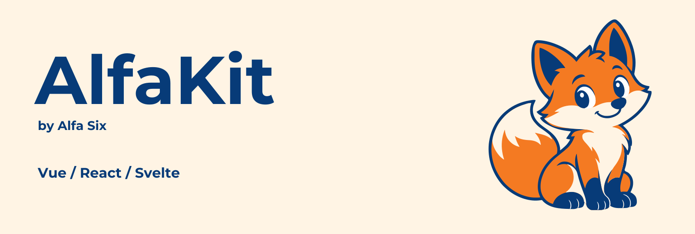
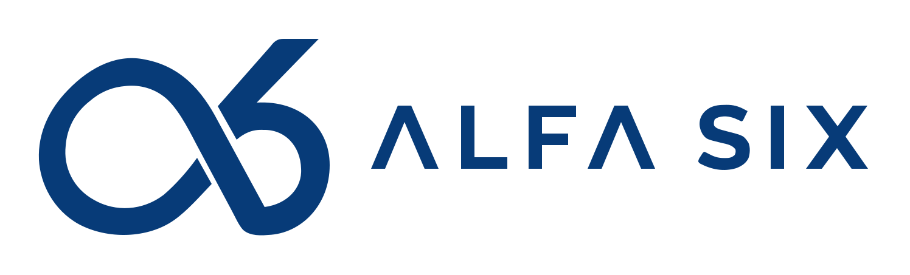

<p align="center">
  
</p>

<p align="center">
  Your Laravel foundation. Your frontend choice.<br>
  An admin panel builder for Laravel by <a href="https://alfasixbh.com">Alfa Six</a>.
</p>

<p align="center">
  <a href="https://alfasixbh.com"><picture><source media="(prefers-color-scheme: dark)" srcset="art/alfasix/alfa-six-compact-white.svg"></picture></a>
</p>

<p align="center">
  <a href="https://packagist.org/packages/alfasix/alfakit"></a>
  <a href="https://www.npmjs.com/package/@alfakit/core"></a>
  <a href="LICENSE.md"></a>
  
</p>

---

> **Status: beta.** AlfaKit 0.1 is a public beta and open source under the [MIT License](LICENSE.md). Public APIs may still change before 1.0, so pin your versions and read the [changelog](CHANGELOG.md) before you update.

AlfaKit lets you build complete admin panels — resources with forms and tables, actions with modals, dashboards with widgets, notifications, multi-tenancy and authentication — **entirely in PHP**, and render them with the JavaScript framework your Laravel app already uses: **React, Vue or Svelte**, through Inertia.js and shadcn-style components.

```php
class PostResource extends Resource
{
    protected static ?string $model = Post::class;

    public static function form(Schema $schema): Schema
    {
        return $schema->components([
            TextInput::make('title')->required()->live(onBlur: true)
                ->afterStateUpdated(fn (Set $set, ?string $state) => $set('slug', str($state)->slug())),
            TextInput::make('slug')->required()->unique(ignoreRecord: true),
            Select::make('author_id')->relationship('author', 'name')->searchable()->preload(),
            RichEditor::make('content')->columnSpanFull(),
        ]);
    }

    public static function table(Table $table): Table
    {
        return $table
            ->columns([
                TextColumn::make('title')->searchable()->sortable(),
                TextColumn::make('author.name')->sortable(),
                TextColumn::make('status')->badge(),
                ToggleColumn::make('is_featured'),
            ])
            ->filters([SelectFilter::make('status')->options([...]), TrashedFilter::make()])
            ->recordActions([EditAction::make(), DeleteAction::make()])
            ->bulkActions([DeleteBulkAction::make()]);
    }
}
```

AlfaKit's PHP API is inspired by [Filament](https://filamentphp.com), so if you know Filament you already know AlfaKit's API; thank you to Dan Harrin, the Filament team and its contributors for showing how good a Laravel admin panel builder can be. The difference is the architecture: PHP produces a JSON **schema**, and a thin renderer package turns that schema into shadcn components. Business logic — validation, authorisation, queries, lifecycle hooks — never leaves the server.

## Features

- **Panel builder** — multiple panels, navigation groups, branding, dark mode, global search, user menu.
- **Resources** — list / create / edit / view pages, relation managers, soft deletes, global search, policies.
- **Forms** — 18 field types (text, select with async search, rich editor, repeater, file upload, key-value, …), nested layouts (sections, tabs, wizards, grids), server-side reactive fields (`live()`, `afterStateUpdated()`), relationship-aware saving.
- **Tables** — sorting, global and per-column search, filters, pagination, bulk actions, inline-editable columns, reordering, polling, column toggling.
- **Actions** — buttons, dropdown groups, confirmation modals, modal forms, slide-overs, keyboard shortcuts, lifecycle hooks, prebuilt CRUD actions.
- **Infolists**, **widgets** (stats, Chart.js charts, tables, custom), **notifications** (toasts + database notifications), **multi-tenancy**, **plugins**, and **authentication** pages (login, registration, password reset, email verification, profile).
- **Your design, not ours**: six themes that change the layout and every component's style (classic sidebar, the signature AlfaKit design, top-navigation Minimal, icon-rail Soft, Corporate, and a Filament-style theme), design options you can mix (`->design(layout: 'topbar', nav: 'pill', inputs: 'filled')`), custom themes, slots for adding content anywhere, per-panel stylesheets and replaceable layouts.
- **Agent-ready**: ships [Laravel Boost](https://laravel.com/docs/boost) guidelines and four skills (`php artisan boost:install` picks them up), and the docs publish `llms.txt`, `llms-full.txt` and every page as Markdown, so Claude Code, Cursor, Codex and Copilot write real AlfaKit code.
- **Global by default** — any number of languages with browser detection, a language menu and per-user preferences; full right-to-left layouts (Arabic, Hebrew, Persian, Urdu, …); every ISO 4217 currency with the right precision and symbol (`MoneyInput`, `money()` with minor units); per-user timezones. Translations for 12 languages ship in `alfasix/alfakit-translations`, and `alfakit:lang:add` scaffolds any other.
- **Three renderers**: `@alfakit/react` (shadcn/ui), `@alfakit/vue` (shadcn-vue), `@alfakit/svelte` (shadcn-svelte).

## Requirements

|              | Version                              |
| ------------ | ------------------------------------ |
| PHP          | 8.3+                                 |
| Laravel      | 13                                   |
| Inertia.js   | 3 (`inertiajs/inertia-laravel` ^3.5) |
| Node         | 22+                                  |
| Tailwind CSS | 4                                    |

AlfaKit targets the official Laravel starter kits (React, Vue, Svelte), which already ship Inertia, Tailwind and shadcn.

## Installation

```bash
composer require alfasix/alfakit
php artisan alfakit:install
```

The installer detects your adapter from `package.json`, publishes `config/alfakit.php`, creates `app/Providers/Alfakit/AdminPanelProvider.php`, adds a dedicated Vite entry (`resources/js/alfakit/app.tsx` and `resources/css/alfakit.css`) and installs `@alfakit/react`, `@alfakit/vue` or `@alfakit/svelte`.

Then:

```bash
php artisan make:alfakit-user
php artisan make:alfakit-resource Post --generate
npm run dev
```

Visit `/admin`.

## Documentation

Full documentation lives in [`docs/content`](docs/content) and is published at [alfakit.dev/docs](https://alfakit.dev/docs). Start with:

- [Installation](docs/content/getting-started/installation.md)
- [Panels](docs/content/panels/configuration.md)
- [Resources](docs/content/resources/overview.md)
- [Forms](docs/content/forms/overview.md) · [Tables](docs/content/tables/overview.md) · [Actions](docs/content/actions/overview.md)
- [Frontend adapters](docs/content/adapters/overview.md) and [custom components](docs/content/adapters/custom-components.md)

## Repository layout

This is a monorepo:

| Path                    | Package                        | Description                                                |
| ----------------------- | ------------------------------ | ---------------------------------------------------------- |
| `packages/alfakit`      | `alfasix/alfakit` (Packagist)  | The PHP package                                            |
| `packages/core`         | `@alfakit/core`                | Framework-agnostic schema types and state                  |
| `packages/react`        | `@alfakit/react`               | React renderer (shadcn/ui)                                 |
| `packages/vue`          | `@alfakit/vue`                 | Vue 3 renderer (shadcn-vue)                                |
| `packages/svelte`       | `@alfakit/svelte`              | Svelte 5 renderer (shadcn-svelte)                          |
| `packages/translations` | `alfasix/alfakit-translations` | Language packs (12 languages) for the panel UI             |
| `playground/*`          | —                              | Laravel starter-kit apps for local development             |
| `docs`                  | —                              | Documentation site (Laravel + Inertia, dogfooding AlfaKit) |

See [CONTRIBUTING.md](CONTRIBUTING.md) for the development workflow.

## Security

Please report vulnerabilities privately through GitHub's [private vulnerability reporting](https://github.com/alfasixbh/alfakit/security/advisories/new). See [SECURITY.md](SECURITY.md).

## License

AlfaKit is open-source software licensed under the [MIT license](LICENSE.md). AlfaKit by Alfa Six. The AlfaKit name, fox mascot and logos are brand assets of Alfa Six and are not covered by the MIT license.
